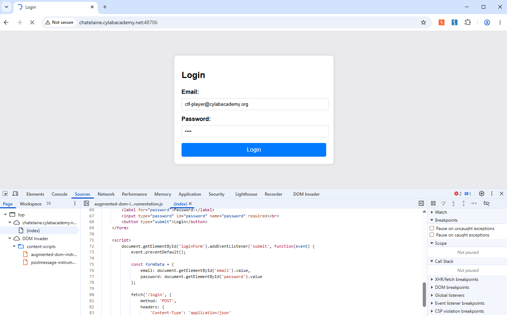
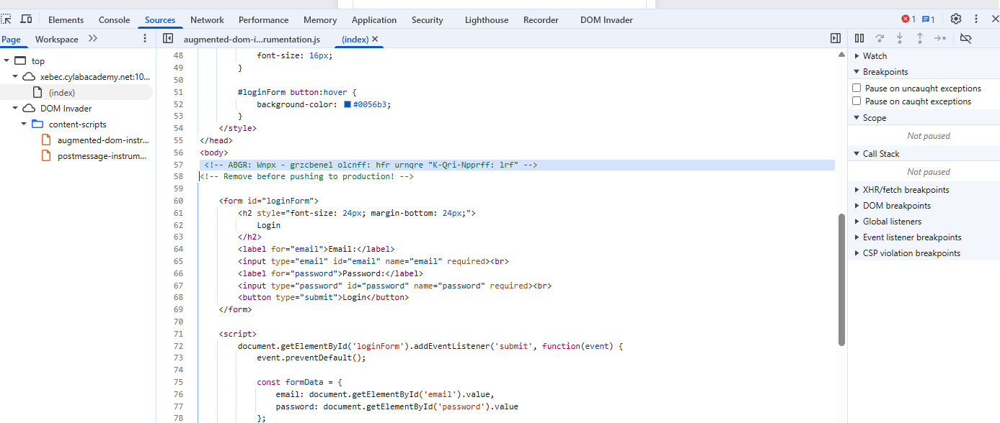
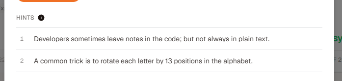
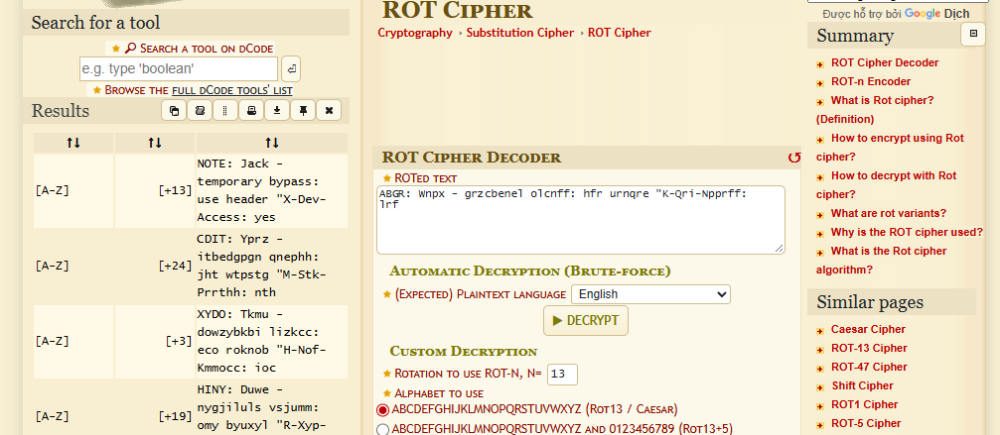
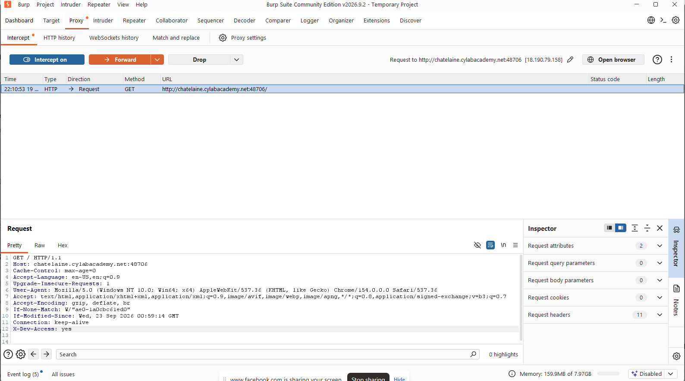
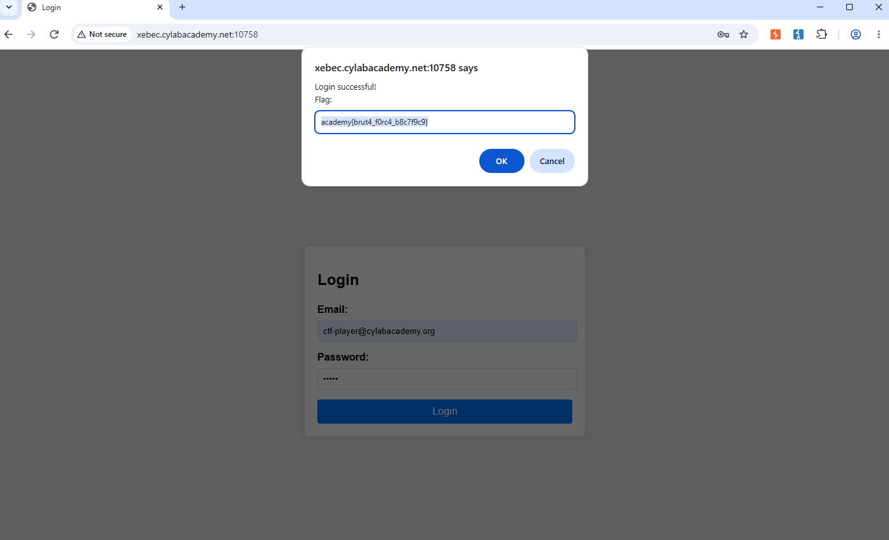

# Crack the Gate 1
Thực hiện truy cập vào web bằng brup site 

Khi check file source, ta thấy dòng mã lạ

Như hint, ta có thể thấy đây là một dòng mã có thể giúp tìm ra flag

Dùng hint 2, thuật toán Rot, ta có dòng chữ 
> NOTE: Jack - temporary bypass: use header "X-Dev-Access: yes

Vì đó là lệnh để giúp web biết đây là dev nên ta có thể khai thác lỗ hỏng đó qua cách gửi pack có dòng này.
Ở phần inter, ta thực hiện thêm và foward nó 

Kết quả flag 
