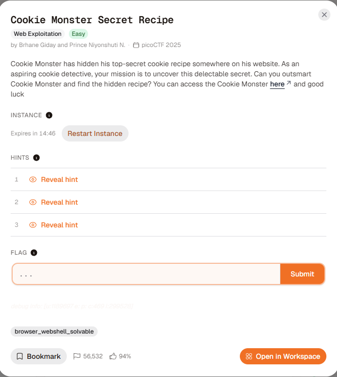
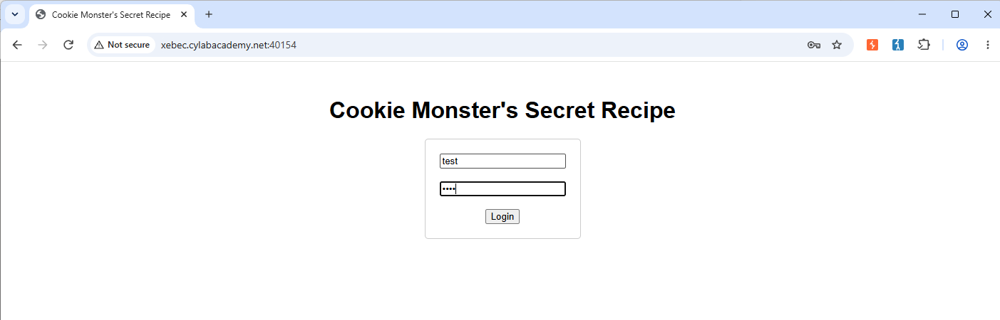
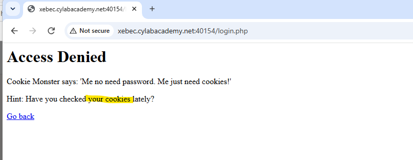
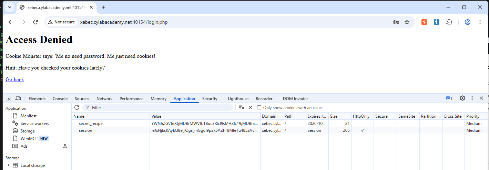
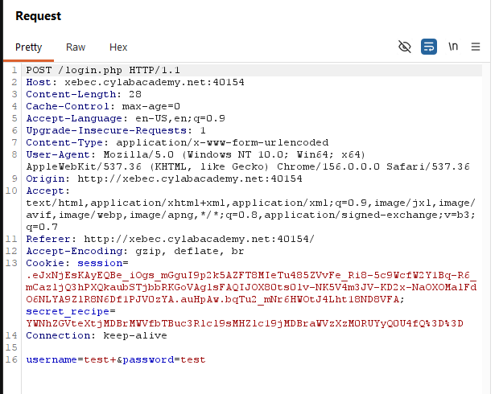
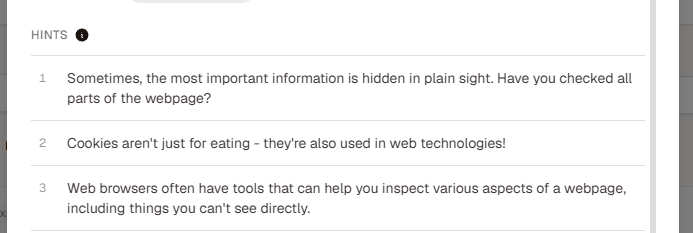
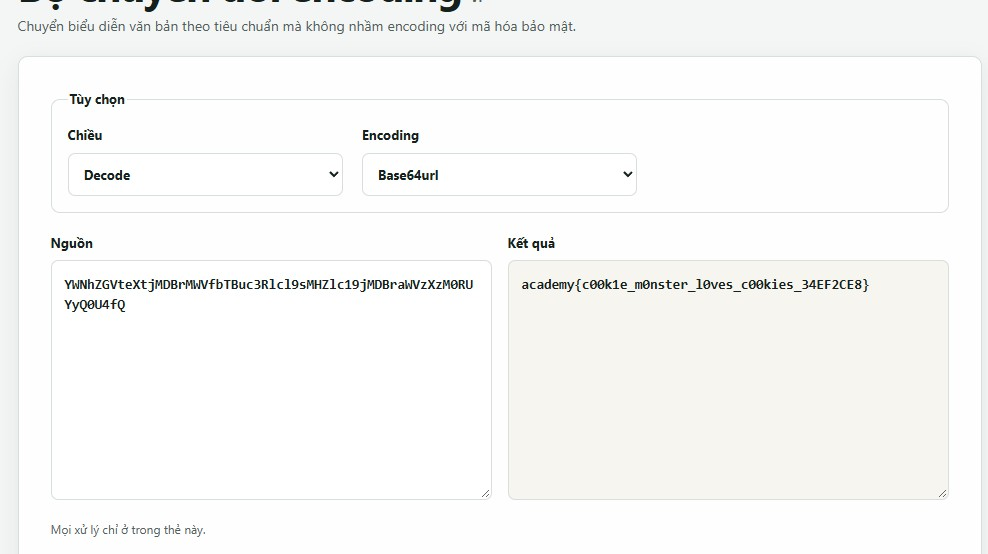

# Cookie Monster Secret Recipe

First, just test

And we got hint

So let's take a look in cookie

We have two cookies, but the 'secret' look more sus...
but the big promblem is the test say need cookie -> flag in cookie (?)

and yeah...time to check a hint

I notice the hint 3, we can look directly -> maybe that cookie have been encode!!

The cookie `YWNhZGVteXtjMDBrMWVfbTBuc3Rlcl9sMHZlc19jMDBraWVzXzM0RUYyQ0U4fQ%3D%3D` turn to be `YWNhZGVteXtjMDBrMWVfbTBuc3Rlcl9sMHZlc19jMDBraWVzXzM0RUYyQ0U4fQ` because %3D often use to '=' in URL encode

