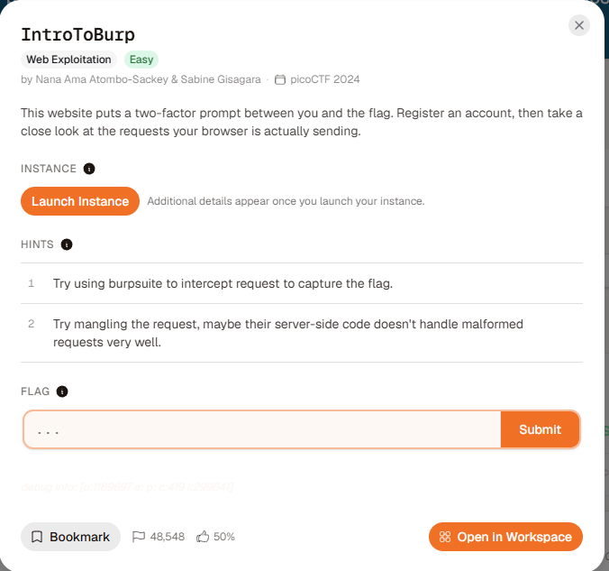
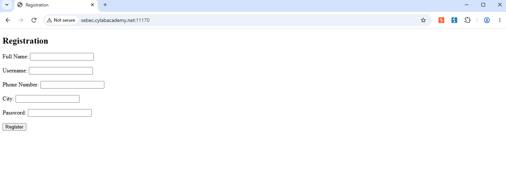
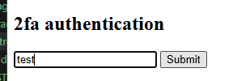
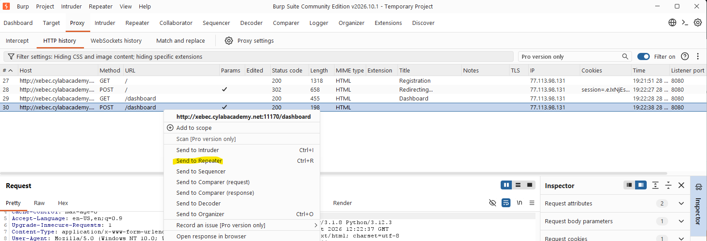
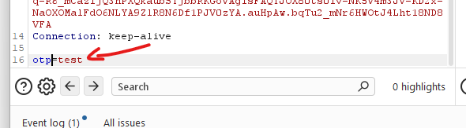
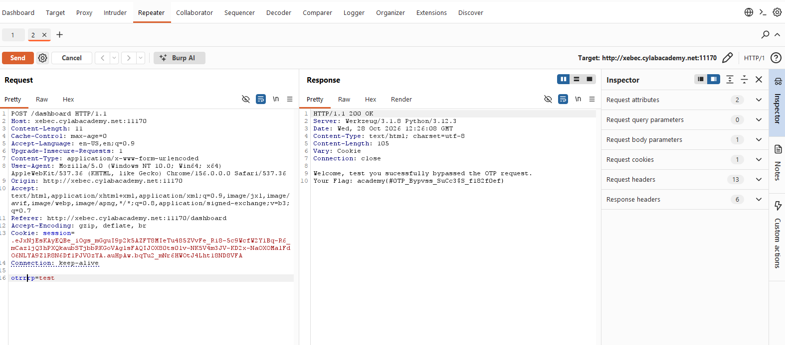
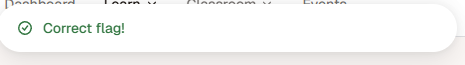

# IntroToBurp

First, we will open BurpSite and open the link.

Then, just test=D

Alright, we go to Burpsite -> Proxy -> HTTP history

At hint 2, they say that we can change some code...

Kinda sus man... so i will change it

And done!

