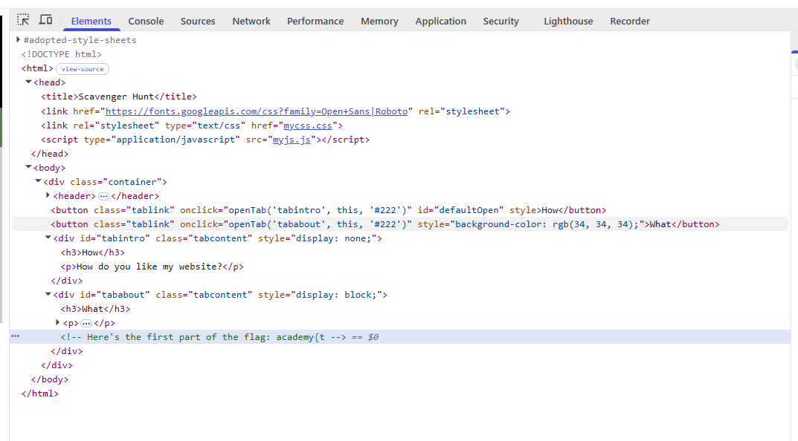
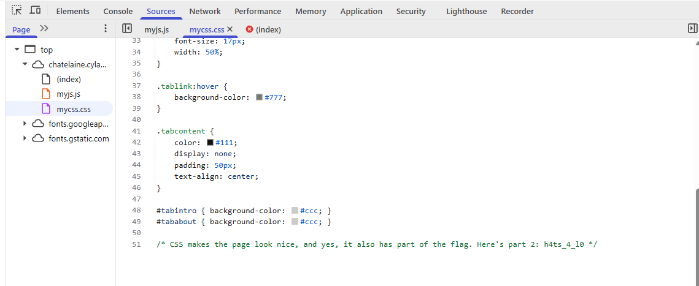
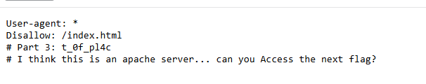
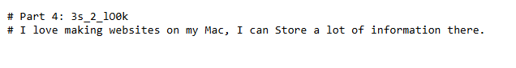
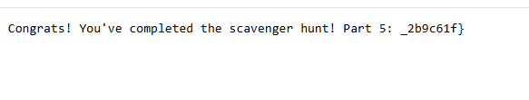

# Scavenger Hunt

Category: Web Exploitation / Information Gathering 

Objective: Discover hidden information in HTML, CSS, server configurations, and system files to collect the 5 parts of the CTF Flag.

---
### HTML Source Analysis

**File:** `index.html`
**Technique:** Source Code Inspection

**Steps:**
1. Open the webpage and view the source code (Right-click $\rightarrow$ **View Page Source** or use **Inspect Element**).
2. Search for the keyword `flag` or look inside HTML comments (`<!-- -->`).
3. In the `<body>` section, there is a hidden comment:
   ```html
   <!-- Here's the first part of the flag: academy-->
   ```



**Flag Part 1:** `academy{t`

### CSS Source Analysis

**File:** `style.css`
**Technique:** Inspecting External Stylesheets

**Steps:**
1. Open Developer Tools (F12) and navigate to the **Sources** tab.
2. Open the `style.css` file.
3. Scroll to the bottom of the file to find a comment containing the flag:
   ```css
   /* Oh! maybe the page look nice, and yes, it also has part of the flag. Here's part 2: h4ck_U_*/
   ```


**Flag Part 2:** `h4ts_4_l0`


### robots.txt

**File:** `robots.txt`
**Technique:** Accessing Common Configuration Files

**Steps:**
1. Navigate to `http://<target>/robots.txt` in your browser.
2. Read the file contents. While it contains directives for bots, it also includes a comment with the flag:
   ```text
   User-agent: *
   Disallow: /index.html
   # Part 3: t_0f_pl4c
   # I think this is an apache server... can you Access the next flag?
   ```




**Flag Part 3:** `t_0f_pl4c`

### .htaccess

**File:** `.htaccess`
**Technique:** Accessing Apache Configuration Files

**Steps:**
1. Navigate to `http://<target>/.htaccess` in your browser.
2. This file controls Apache web server settings. It contains a comment with the next flag part:
   ```apache
   # Part 4: 3s_2_100k
   # I love making websites on my Mac, I can Store a lot of information there.
   ```



**Flag Part 4:** `3s_2_lO0k`


### .DS_Store

**File:** `.DS_Store`
**Technique:** Accessing System Metadata Files

**Steps:**
1. Navigate to `http://<target>/.DS_Store` in your browser.
2. `.DS_Store` is a hidden file created by macOS to store custom attributes of a folder. In this challenge, it contains a text response:
   ```text
   Congrats! You've completed the scavenger hunt! Part 5: _2b9c61f}
   ```



**Flag Part 5:** `_2b9c61f`

---

### Final Flag

Combining all the parts in order:

```
academy{th4ts_4_l0t_0f_pl4c3s_2_100k_2b9c61f}
```


---

### 📝 Key Takeaways

1.  **Source Code Visibility:** Never trust that comments in HTML or CSS are hidden from the user. They are visible to anyone who inspects the source.
2.  **robots.txt is not Security:** This file is public. Attackers often check it to find paths that administrators don't want search engines to index, but they forget that it also reveals the file structure.
3.  **Sensitive File Leakage:** Files like `.htaccess` (server config) and `.DS_Store` (macOS metadata) should never be accessible via a web browser. Web servers should be configured to deny access to files starting with a dot (`.`).